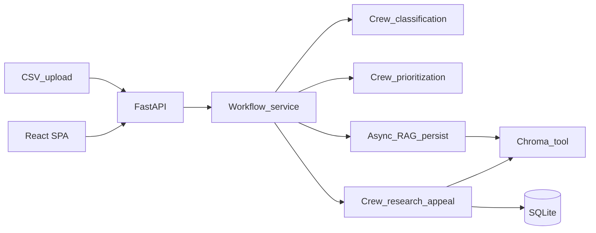

# DenialFlow AI (POC)

AI-native **healthcare denial resolution** platform: ingest denied claims, run a **CrewAI** multi-agent workflow (classification → prioritization → RAG → appeal drafting), pause for **human-in-the-loop** review, and surface **operational + financial metrics**.

> Synthetic demo data only. Not for production PHI processing.

## Architecture

- **Backend**: FastAPI (async IO + background workflow runs), SQLite (`aiosqlite`), structured logging (`structlog`), request correlation (`request_id` / `trace_id`), in-memory ops metrics.
- **Agents**: CrewAI crews for (1) denial classification, (2) financial prioritization, (3) research + appeal drafting (includes a **ChromaDB** retrieval tool).
- **RAG**: OpenAI embeddings + Chroma persistent store under `data/chroma/`.
- **Frontend**: React + TypeScript SPA built with Vite; React Router handles navigation, TanStack Query manages API data, and the client communicates with FastAPI over HTTP.
- **Authentication**: account registration and login issue JWT bearer tokens; the SPA stores the session in the browser and sends the token with API requests.



## Quickstart

### 1) Create a virtualenv (recommended)

CrewAI pulls optional telemetry-related dependencies; using an **isolated venv** avoids conflicts with a global Anaconda install.

```bash
python -m venv .venv
.\.venv\Scripts\activate
python -m pip install -U pip
python -m pip install -r requirements.txt
```

### 2) Configure environment

Copy `.env.example` → `.env` and set `OPENAI_API_KEY`.

**API authentication**:

```bash
# .env
JWT_AUTH_ENABLED=true
JWT_SECRET=your-long-random-secret
```

With `JWT_AUTH_ENABLED=true`, users can create an account and sign in through the frontend; the API issues JWTs signed with `JWT_SECRET`. `/health` remains public. The optional `API_ACCESS_TOKEN` provides a static bearer token for trusted API clients and scripts. Do not put it in `frontend/.env.local` or expose it as `VITE_API_ACCESS_TOKEN` in a deployed frontend: Vite embeds `VITE_*` values in public browser assets. For local development only, set `JWT_AUTH_ENABLED=false` to disable authentication.

**AgentOps** (optional LLM/agent tracing): set `AGENTOPS_API_KEY` from [AgentOps](https://app.agentops.ai/settings/projects). Leave empty to skip initialization. The API calls `agentops.init()` once at startup (CrewAI is auto-instrumented per [the CrewAI integration](https://docs.agentops.ai/v2/integrations/crewai)); each workflow run and Bedrock AI review opens its own session and ends it when finished, so Session Replay links work after the run completes—not the placeholder `default` trace printed at server startup. On Windows, if you see `UnicodeEncodeError` from emoji in AgentOps logs, restart the API after pulling latest code (stdout is forced to UTF-8) or set `PYTHONUTF8=1`.

### 3) Generate demo CSV + seed the vector store

```bash
python scripts/generate_sample_csv.py
python scripts/seed_vectorstore.py
```

`seed_vectorstore.py` will chunk `data/seed_documents/*.md`, embed with `OPENAI_EMBEDDING_MODEL`, and upsert into Chroma collection `denialflow_corpus`.

### 4) Run API + UI

Configure the frontend by copying `frontend/.env.example` to `frontend/.env.local`. Set `VITE_API_BASE` to the API URL (the default is `http://127.0.0.1:8000`); leave `VITE_API_ACCESS_TOKEN` empty when using account login.

Terminal A — API (run from the repository root):

```bash
python -m uvicorn denialflow_ai.api.app:app --reload --host 127.0.0.1 --port 8000
```

Terminal B — frontend:

```bash
cd frontend
npm ci
npm run dev
```

Open `http://localhost:5173`, create an account or sign in, then use **Dashboard → Upload claims → Workflow runs → Claims analysis → Appeal review**. The frontend also includes the **Knowledge base** view.

To create a production frontend build, run `npm run build` from `frontend/`; the generated static assets are written to `frontend/dist/`. Set `VITE_API_BASE` to the deployed API URL before building, and review the API's CORS policy before exposing the deployment publicly.

## CSV columns

Required: `claim_id`.

Clinical / financial (existing): `payer`, `denial_code`, `denial_reason_text`, `billed_amount`, `allowed_amount`, `patient_balance`, `aging_days`, `specialty`, `cpt_codes`, `icd10_codes`, `service_date`, `remark_codes`.

**Letterhead / cadastro** (optional; recommended so appeal drafts use real names and addresses instead of `[Your Company Name]` placeholders):

| Column | Description |
|--------|-------------|
| `provider_name` | Billing organization name |
| `provider_address` | Street address |
| `provider_city`, `provider_state`, `provider_zip` | Provider mailing city/state/ZIP |
| `signer_name`, `signer_title` | Signature block |
| `provider_npi` | NPI (optional) |
| `payer_address`, `payer_city`, `payer_state`, `payer_zip` | Payer mailing block (`payer` column = payer name) |
| `letter_date` | Letter date (ISO); if empty, workflow uses today |

Regenerate the demo file with letterhead: `python scripts/generate_sample_csv.py`.

## Example API payloads

### Start workflow

```json
POST /v1/workflows/run
{
  "batch_id": "<uuid from upload>",
  "max_claims": 3
}
```

### Human review

Appeal Review UI shows two separate opinions (vertical layout):

1. **1ª opinião** — appeal draft from CrewAI/Groq (workflow).
2. **Documentos RAG** — citations used in context.
3. **2ª opinião** — Bedrock analyzes the draft (on demand); does not replace the first.
4. **Human decision** — approve, edit, or reject. **Approve** and **edit** can trigger an e-mail with the final appeal text (Gmail API).

```json
POST /v1/appeals/<appeal_id>/ai-review
```

No body. Requires AWS credentials and `BEDROCK_MODEL_REVIEW` enabled in `.env`. Persists `ai_review_json` on the appeal.

```json
POST /v1/appeals/<appeal_id>/reject
{ "reason": "Insufficient documentation for policy section X." }
```

```json
POST /v1/appeals/<appeal_id>/edit
{ "final_text": "...", "reason": "Legal tone adjustment" }
```

**Bedrock (second opinion only)** — add to `.env`:

```env
AWS_REGION=us-east-1
BEDROCK_MODEL_REVIEW=anthropic.claude-3-5-sonnet-20241022-v2:0
BEDROCK_REVIEW_ENABLED=true
BEDROCK_REVIEW_USE_CREWAI=false
# Optional: use Groq when Bedrock daily token quota is exceeded
BEDROCK_REVIEW_FALLBACK_GROQ=false
```

Enable model access in the AWS Bedrock console for your region. The workflow still uses `LLM_PROVIDER=groq`; only `POST .../ai-review` calls Bedrock.

The second opinion sends the **appeal draft** (`draft_text`) plus **reference documents** from the knowledge base (Chroma embeddings): by default the RAG hits stored on the appeal (`citations_json`); set `BEDROCK_REVIEW_RAG_REFRESH=true` to re-query Chroma with the draft text. Classification and prioritization are not sent to Bedrock.

If you see `bedrock_quota_exceeded` / “Too many tokens”, the account hit Bedrock quota/throttle for that model in `AWS_REGION`. Wait for the UTC reset, request a quota increase under **Bedrock → Quotas**, switch `BEDROCK_MODEL_REVIEW`, or set `BEDROCK_REVIEW_FALLBACK_GROQ=true` (second opinion via Groq; `model_used` is prefixed with `groq-fallback:`).

### AWS CLI and S3 document copies (optional)

The knowledge-base API can optionally keep an S3 copy of documents uploaded to or updated in Chroma. Chroma remains the local vector index; S3 stores the original file at `s3://<bucket>/<prefix>/<collection>/<filename>`. Deleting a document or collection from the knowledge base does **not** delete its S3 object. If `AWS_S3_BUCKET` is empty, S3 copying is disabled.

Install AWS CLI v2 (Windows):

```powershell
winget install -e --id Amazon.AWSCLI
aws --version
```

Create an IAM user/profile for local development (do not use root credentials), then configure and verify it:

```powershell
aws configure --profile denialflow
aws sts get-caller-identity --profile denialflow
$env:AWS_PROFILE = "denialflow"
```

When prompted, enter the IAM access key, secret, default region (for example `us-east-1`), and `json`. In AWS-hosted environments, prefer an IAM role or temporary credentials over static keys.

Create a bucket with a globally unique name. For `us-east-1`:

```powershell
$Bucket = "denialflow-your-unique-bucket-name"
$Region = "us-east-1"
aws s3api create-bucket --bucket $Bucket --region $Region --profile denialflow
aws s3api put-public-access-block --bucket $Bucket --profile denialflow --public-access-block-configuration "BlockPublicAcls=true,IgnorePublicAcls=true,BlockPublicPolicy=true,RestrictPublicBuckets=true"
```

For a region other than `us-east-1`, add `--create-bucket-configuration LocationConstraint=$Region` to the `create-bucket` command. Keep all public-access blocks enabled. Give the API's IAM identity only `s3:PutObject` on `arn:aws:s3:::<your-bucket>/collections/*`; bucket provisioning permissions are not needed at runtime.

Set these values in the repository-root `.env`:

```env
AWS_REGION=us-east-1
AWS_S3_BUCKET=denialflow-your-unique-bucket-name
AWS_S3_PREFIX=collections

# Leave blank when the API uses AWS_PROFILE or an IAM role.
AWS_ACCESS_KEY_ID=
AWS_SECRET_ACCESS_KEY=
# AWS_SESSION_TOKEN=  # only for temporary credentials supplied directly
```

`AWS_REGION` is also used for Bedrock. With a local profile, start the API from the terminal where `AWS_PROFILE=denialflow` is set. Alternatively, provide credentials via the environment variables above; do not commit real credentials or `.env`. After uploading a document in **Knowledge base**, the API response's `s3` field reports `uploaded` with the bucket and key, `disabled` when no bucket is configured, or `failed` if S3 upload did not succeed.

More examples: [`examples/http/api.http`](examples/http/api.http).

### E-mail on human approve/edit (Gmail API / GCP)

When a reviewer **approves** or **submits an edit**, the API e-mails the same text saved as `final_text` to `GMAIL_TO`. **Reject** does not send e-mail.

**Personal Gmail** (e.g. `test@gmail.com`):

1. Enable **Gmail API** on your GCP project.
2. Create an **OAuth 2.0 Client ID** (type Web or Desktop), download JSON to `gcp/key_gmail.json` (gitignored).
3. In the OAuth client, add redirect URIs: `http://localhost:8080/` and `http://127.0.0.1:8080/`.
4. `.env`:

```env
GMAIL_NOTIFY_ENABLED=true
GMAIL_SERVICE_ACCOUNT_FILE=gcp/key_gmail.json
GMAIL_OAUTH_TOKEN_FILE=gcp/gmail_token.json
GMAIL_IMPERSONATE_USER=test@gmail.com
GMAIL_TO=test@gmail.com
```

5. One-time authorization (sign in as that Gmail account):

```bash
pip install google-auth-oauthlib
python scripts/gmail_authorize.py
```

6. Restart the API.

**Google Workspace** (service account): use a JSON key with `"type": "service_account"`, enable domain-wide delegation, set `GMAIL_IMPERSONATE_USER` to the mailbox to send as. OAuth token file is not used.

If sending fails, the appeal decision is still saved unless `GMAIL_FAIL_ON_ERROR=true`. Audit log: `email_sent`, `email_skipped`, or `email_failed`.

## Embeddings example (conceptual)

Each chunk is embedded with `text-embedding-3-small` (configurable) and stored in Chroma with metadata:

```json
{
  "id": "horizon_national_imaging_policy:2",
  "metadata": { "source": "horizon_national_imaging_policy.md", "title": "Horizon National Imaging Policy", "chunk": "2" },
  "document": "# Horizon National — Clinical Policy Memo..."
}
```

## Workflow states (persisted)

`pending → classified → prioritized → retrieved → awaiting_review → approved|rejected|edited`

## Production evolution (suggested)

- **Security / compliance**: RBAC, SSO, immutable audit storage, encryption at rest/in transit, BAA-aligned hosting, PHI boundary controls.
- **Scale**: queue (Celery/RQ/SQS), idempotent workflow steps, horizontal workers, secrets manager.
- **Quality**: offline eval sets, hallucination guardrails, citation verification, model routing by claim complexity.
- **Data**: Qdrant/Managed vector, document ingestion pipelines, de-identification tooling.

## Repo map

- `denialflow_ai/` — application code (API, services, crews, RAG, repos)
- `frontend/` — React + TypeScript SPA (Vite, pages, API client and session context)
- `data/seed_documents/` — synthetic policy + archived appeal snippets
- `scripts/` — dataset + vector seed utilities
- `tests/` — minimal unit tests

## License

POC / demonstration purposes.
